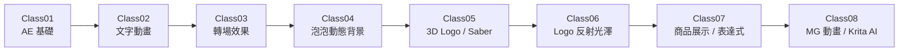

# 8042 AE After Effects 圖像特效動畫基礎 A 班

這是一份以課堂日期為主軸整理的免費、非營利學習紀錄，包含個人筆記、課程索引、完整上課錄影與老師提供的參考影片連結。

整理者：`4pins`。為尊重低調授課的意願，本專案不公開教師姓名／稱呼與開課單位。

> 課程期間：2026-04-18 ～ 2026-06-13  
> YouTube 播放清單：[8042 AE圖像特效動畫基礎A班第01期](https://www.youtube.com/playlist?list=PLM0Fy4A8jLFA)

## 課程索引

| 堂次 | 日期 | 課程頁 | 完整錄影 |
|---|---|---|---|
| Class01 | 2026-04-18 | [課程筆記](classes/2026-04-18-Class01/README.md) | 當日未開直播，無完整錄影 |
| Class02 | 2026-04-25 | [課程筆記](classes/2026-04-25-Class02/README.md) | [YouTube](https://www.youtube.com/watch?v=29lG0NDNFMs) |
| Class03 | 2026-05-09 | [課程筆記](classes/2026-05-09-Class03/README.md) | [YouTube](https://www.youtube.com/watch?v=7kBERVJ9_kM) |
| Class04 | 2026-05-16 | [課程筆記](classes/2026-05-16-Class04/README.md) | [A](https://www.youtube.com/watch?v=kNvNzohMu4Y)／[B](https://www.youtube.com/watch?v=_HV_9bshpvk) |
| Class05 | 2026-05-23 | [課程筆記](classes/2026-05-23-Class05/README.md) | [YouTube](https://www.youtube.com/watch?v=4cvvlCR2EKg) |
| Class06 | 2026-05-30 | [課程筆記](classes/2026-05-30-Class06/README.md) | [YouTube](https://www.youtube.com/watch?v=xCtS1qukfcM) |
| Class07 | 2026-06-06 | [課程筆記](classes/2026-06-06-Class07/README.md) | [YouTube](https://www.youtube.com/watch?v=CDC5p_lSVFU) |
| Class08 | 2026-06-13 | [課程筆記](classes/2026-06-13-Class08/README.md) | [YouTube](https://www.youtube.com/watch?v=zyp1I8KUz1U) |

## 學習路線

目前正在比較三種較大版面的學習路線圖，請先查看 [直式、雙欄蛇形、四階段三個候選版本](docs/LEARNING_ROUTE_OPTIONS.md)。選定後再取代下方原始橫式版本。

## 使用方式

1. 從上表選擇日期與堂次。
2. 先閱讀該堂課筆記與素材來源。
3. 需要完整操作過程時，再開啟對應的 YouTube 錄影。
4. 老師參考影片與外部素材會保留原始來源連結。

每堂頁面另附原始增量筆記、圖片來源對照 JSON，以及經篩選的練習 AEP。原始八份累積文件共有 174 個圖片副本；去除跨堂重複後，逐堂內容實際使用 27 張圖片。

## 授權與聲明

- 本 Repo 的原創文字、圖表與整理程式採 [MIT License](LICENSE)。
- 課程錄影與第三方教材、商標、圖片、影片及外掛仍各自受原權利人條款約束。
- 本專案為無償、非營利的學習紀錄。詳見 [NOTICE.md](NOTICE.md)。
- AEP、外掛與第三方素材的公開範圍詳見 [素材與授權政策](docs/ASSET_AND_LICENSE_POLICY.md)。
- 發現錯誤或連結失效，歡迎使用 GitHub Issues 回報。

## 專案狀態

請參考 [docs/TODO.md](docs/TODO.md) 與 [docs/PROJECT_STATUS.md](docs/PROJECT_STATUS.md)。
