# 2026-04-18-Class01 原始增量筆記

> 本檔由累積式課堂筆記依日期／主題邊界擷取，僅做圖片路徑改寫；文字保留原貌供追溯。
> 來源：`Markdown/2026-04-18-Class01/2026-04-18-1Class01.md` 第 15–65 行。

## 2026-04-18-Class01-上午

- 教師：不公開（依專案公開設定隱去）

- 課程目標:        特效    特定素材特定內容

- 動態講義-    After Effects 基礎介紹

<https://www.youtube.com/playlist?list=PLsEaLmxyXerCbhP2_iMkDYMlSiEH37Z0E>

- 靜態講義-

<https://www.notion.so/1-After-Effect-1ec8f2f6bd548044a077e088659749f3>

- General setting    > media anchor

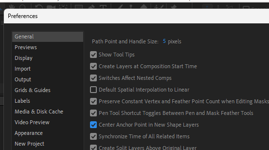

- 選完資料夾都要清空一次

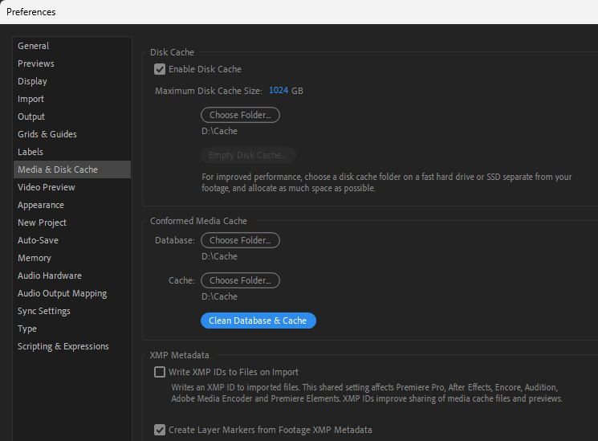

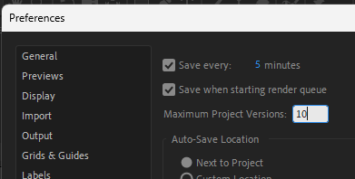

- 通常每20-30min清空一次

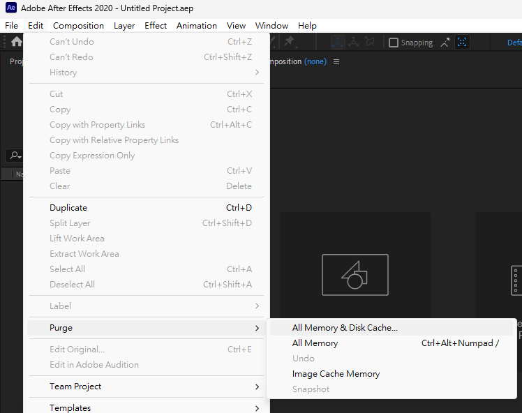

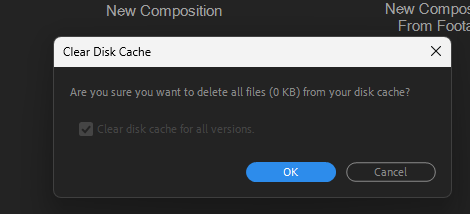

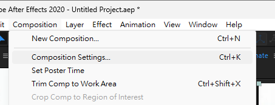

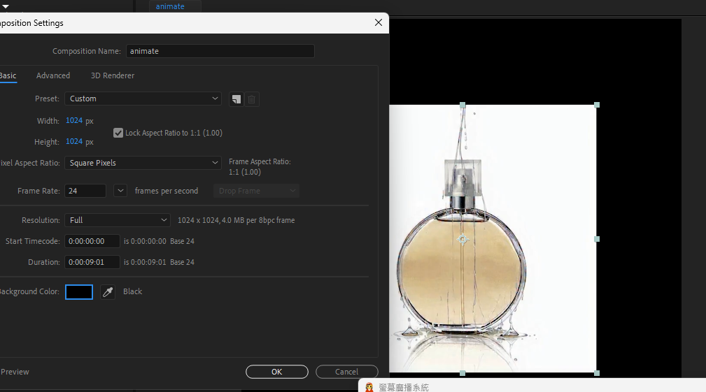

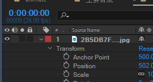

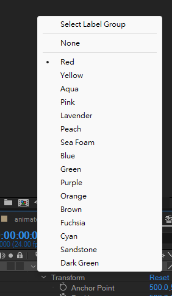

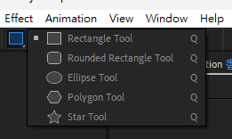

- Track matte

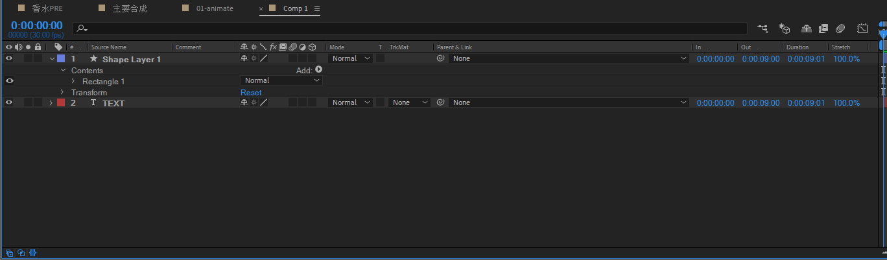

## 2026/04/18-下午-AE

<https://www.notion.so/1-After-Effect-1ec8f2f6bd548044a077e088659749f3>

<https://www.youtube.com/playlist?list=PLsEaLmxyXerCbhP2_iMkDYMlSiEH37Z0E>

- a
