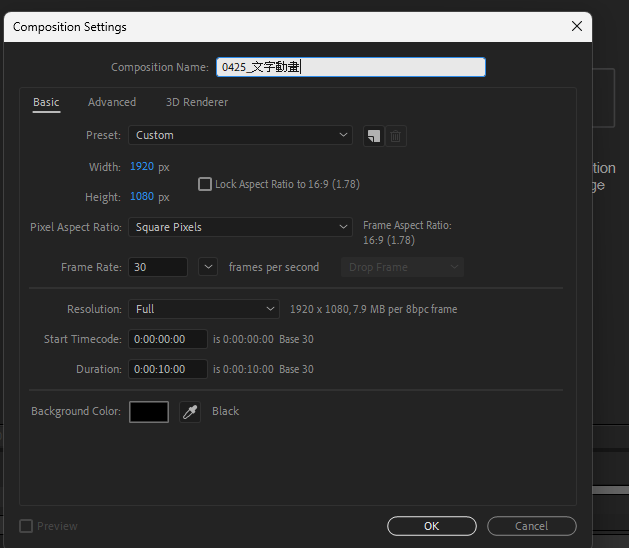
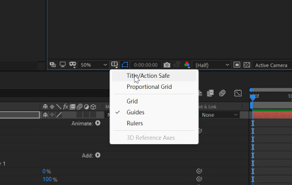
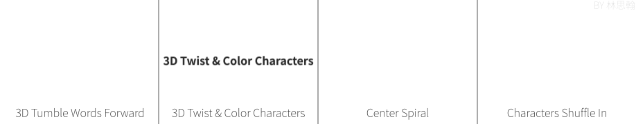
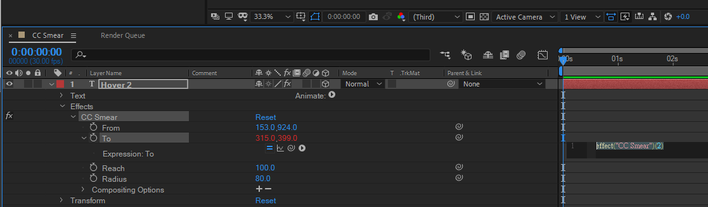
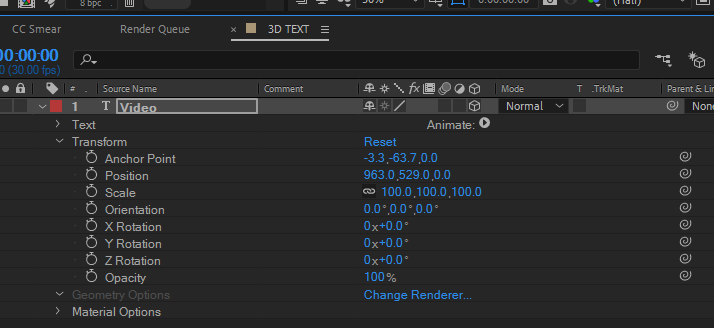
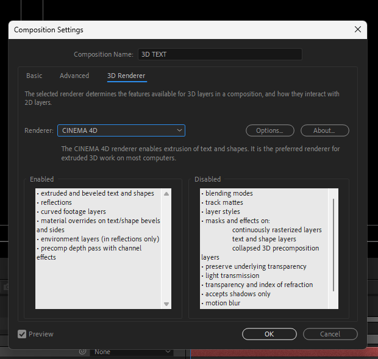

# 2026-04-25-Class02 原始增量筆記

> 本檔由累積式課堂筆記依日期／主題邊界擷取，僅做圖片路徑改寫；文字保留原貌供追溯。
> 來源：`Markdown/2026-04-25-Class02/2026-04-25-Class2.md` 第 66–118 行。

## 2026/04/25-上午-AE

<https://www.notion.so/1-After-Effect-1ec8f2f6bd548044a077e088659749f3>

<https://www.youtube.com/playlist?list=PLsEaLmxyXerCbhP2_iMkDYMlSiEH37Z0E>

- **<u>5.文字Motion Graphics Animation</u>**

<https://youtu.be/TS-pK9jilJI>

<https://www.youtube.com/playlist?list=PLsEaLmxyXerAzfNd60oQwP2wb2ID7jFyV>



- 對其種類

  - Paragraph

  - Align

- 1文字動畫 Animate offset 擴充設定 Ramp up 緩進緩出Ease high

<https://youtu.be/tEDg0XcQa1s?si=6F5qcCp-I76xXjjZ>



- AE內建328種文字特效預覽 (After Effects Text Presets GIF)

<https://medium.com/@linhans/ae%E5%85%A7%E5%BB%BA328%E7%A8%AE%E6%96%87%E5%AD%97%E7%89%B9%E6%95%88-after-effects-text-presets-gif-303e9c64004d>



### 2 After Effect 操作入門

<https://www.notion.so/2-After-Effect-1ec8f2f6bd548081b3d7f3708feee501>

- 表達式範例

```
myFx = effect("CC Smear")("From");
```

```
myFx - [0,30]
```







- a
