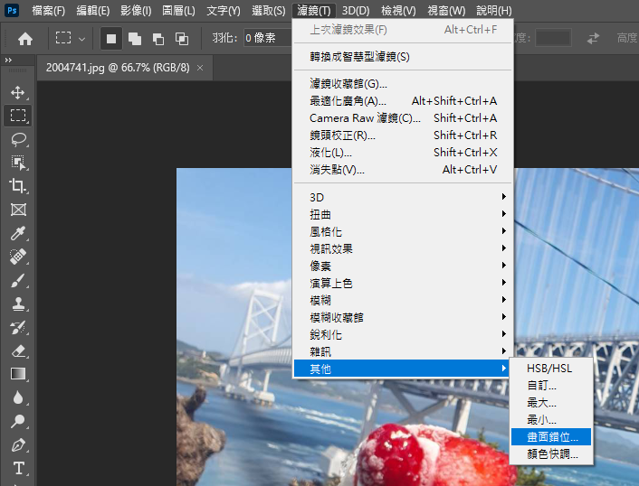
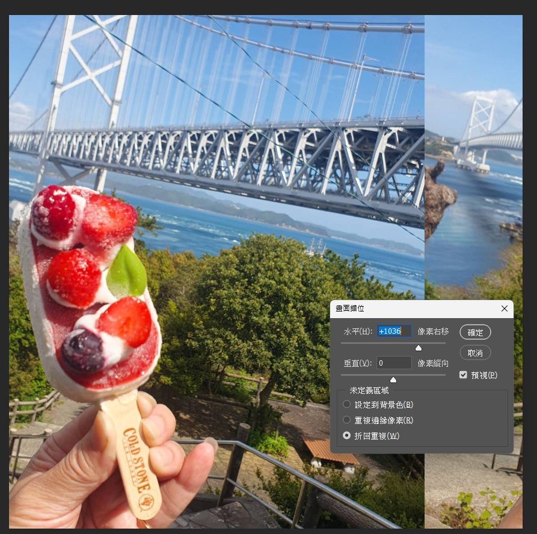
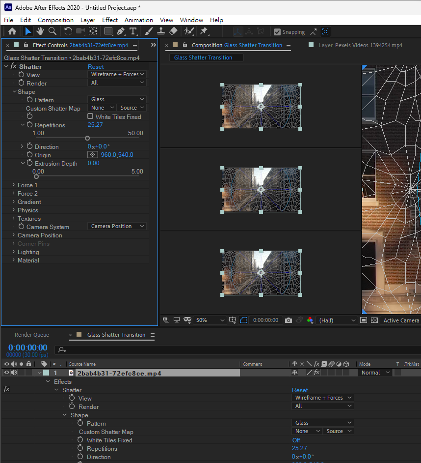

# 2026-05-09-Class03 原始增量筆記

> 本檔由累積式課堂筆記依日期／主題邊界擷取，僅做圖片路徑改寫；文字保留原貌供追溯。
> 來源：`Markdown/2026-05-09-Class03/2026-05-09-Class03.md` 第 68–111 行。

## 2026-05-09-Class03-上午

- AE轉場效果playlist

<https://www.youtube.com/playlist?list=PLsEaLmxyXerChuPQRf9hnPkhpj4HnOUPN>

- 01 square transtion

<https://www.youtube.com/watch?v=yqFZh2ZcD_w&list=PLsEaLmxyXerChuPQRf9hnPkhpj4HnOUPN&index=6>

- 02 Radial Wipe

<https://www.youtube.com/watch?v=05-ZkaxUP00&list=PLsEaLmxyXerChuPQRf9hnPkhpj4HnOUPN&index=5>

- 3 import Directional Blur置入素材影片

<https://www.youtube.com/watch?v=0WtJ1hx3HIE&list=PLsEaLmxyXerChuPQRf9hnPkhpj4HnOUPN&index=4>

- 3 1 Transform&Directional Blur轉場調整圖層02

<https://www.youtube.com/watch?v=aOhmyfgCxO4&list=PLsEaLmxyXerChuPQRf9hnPkhpj4HnOUPN&index=3>

- 4 轉場 Elegant Slide Animation 01

<https://www.youtube.com/watch?v=ri3gUWBadxA&list=PLsEaLmxyXerChuPQRf9hnPkhpj4HnOUPN&index=2>

- 4 1 轉場 Elegant Slide Animation 02

<https://www.youtube.com/watch?v=gf0qH_eAa8Q&list=PLsEaLmxyXerChuPQRf9hnPkhpj4HnOUPN&index=1>

- 上課錄影

<https://www.youtube.com/live/7kBERVJ9_kM>

## 2026-05-09-下午

- a
