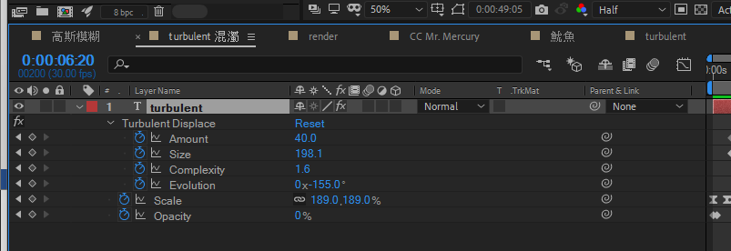
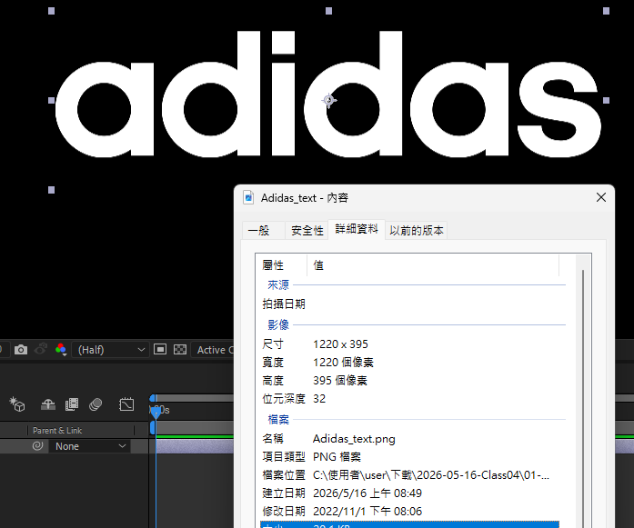

# 2026-05-16-Class04 原始增量筆記

> 本檔由累積式課堂筆記依日期／主題邊界擷取，僅做圖片路徑改寫；文字保留原貌供追溯。
> 來源：`Markdown/2026-05-16-Class04/2026-05-16-Class04.md` 第 165–201 行。

## 2026/05/16-上午-AE

- 串流位置 https://www.youtube.com/live/kNvNzohMu4Y

- AE\_adidas\_泡泡動態背景動畫

<https://www.youtube.com/playlist?list=PLsEaLmxyXerCkrdW02AvU_YhA4ApTO7eU>

1 adidas logo Animate Ramp up offset

<https://www.youtube.com/watch?v=pp0dsX_tR1M>

2 adidas logo Animate CC RepeTille offset Find

<https://www.youtube.com/watch?v=_UmYm4OwAZE>

3 adidas logo Animate Circle Maskanimate

<https://www.youtube.com/watch?v=q-AMDJtQZZs>

4 adidas logo Animate CC Blobbylize Tint Glass Turbulent

<https://www.youtube.com/watch?v=0WLTjIUP3eI>

5 adidas logo C Blobbylize Tint Glass Turbulent與map遮色關係

<https://www.youtube.com/watch?v=w-xHsbqr23I>

- 免費 配樂

<https://zh.500audio.com/>

- a
