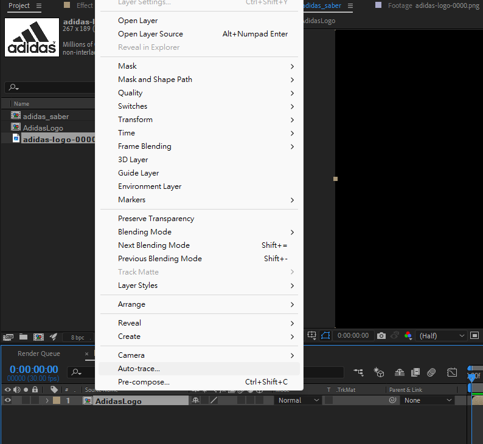
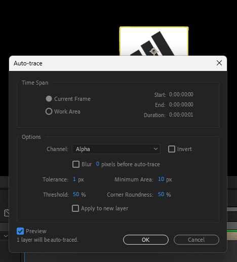
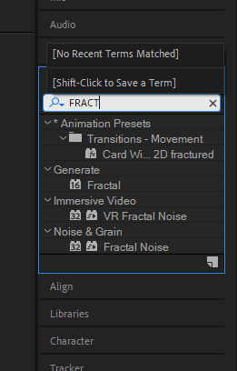

# 2026-05-23-Class05 原始增量筆記

> 本檔由累積式課堂筆記依日期／主題邊界擷取，僅做圖片路徑改寫；文字保留原貌供追溯。
> 來源：`Markdown/2026-05-23-Class05/2026-05-23-Class05.md` 第 202–224 行。

## 2026/05/23-上午-AE

- 上課講義

SABER ELECTRIC Adidas LOGO

<https://www.youtube.com/watch?v=kaZbb5-1aws&list=PLsEaLmxyXerBEuFODXs15ARMv921hRx4-&index=1>

01 3d軟體logo建立

<https://www.youtube.com/watch?v=T0qUGl-aTHw&list=PLsEaLmxyXerBOoxEC6xWbADHgv19PWqgX>

02 控制空物件建立

<https://www.youtube.com/watch?v=8mCkJZ3J2eo&list=PLsEaLmxyXerBOoxEC6xWbADHgv19PWqgX&index=2>

- a
