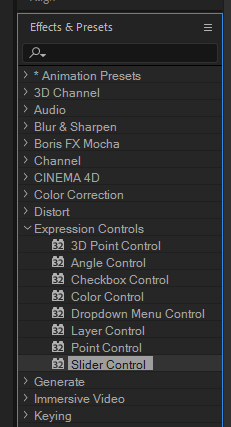
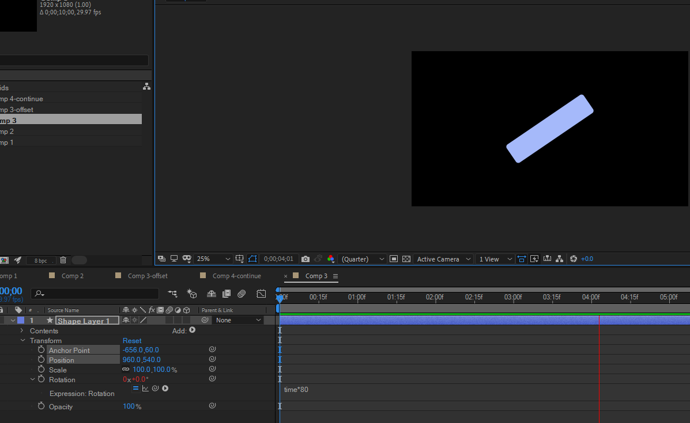

# 2026-06-06-Class07 原始增量筆記

> 本檔由累積式課堂筆記依日期／主題邊界擷取，僅做圖片路徑改寫；文字保留原貌供追溯。
> 來源：`Markdown/2026-06-06-Class07/2026-06-06-Class07.md` 第 269–283 行。

### 4 表達式 expression

<https://app.notion.com/p/4-expression-1fd8f2f6bd5480be9b71c0f19ad190ea>

```
<https://youtube.com/live/CDC5p_lSVFU>
```



- 等分運動



- a
