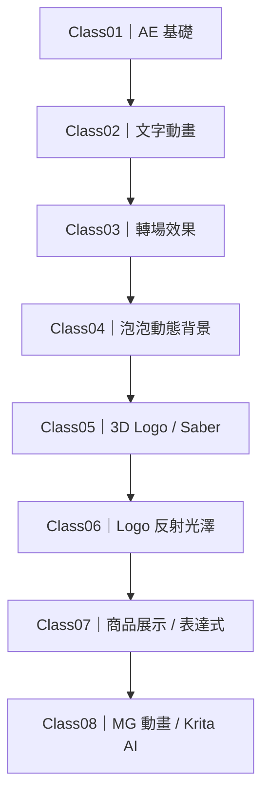
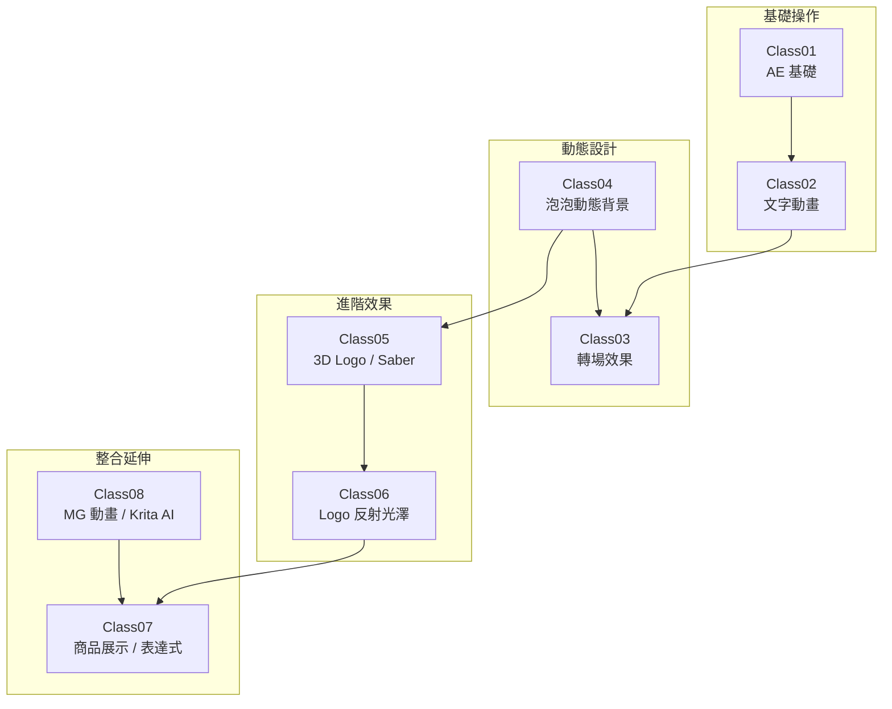
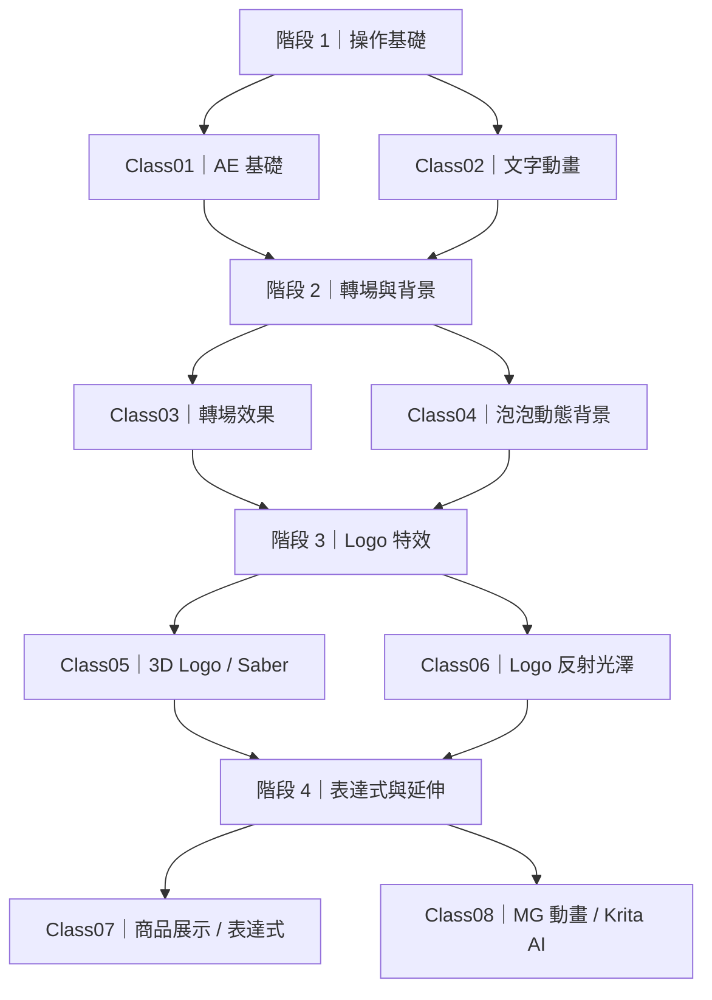

# 學習路線圖：三個候選版本

這三版使用相同八堂課內容，只改變版面。請比較 GitHub 實際渲染後，選擇要放回首頁的版本。

## 版本 A｜直式單一路線

優點：節點最大、手機閱讀清楚、先後順序最直觀。缺點：頁面較高。

## 版本 B｜雙欄蛇形

優點：比原圖高、又不會像直式版那麼長，桌面與手機較均衡。缺點：閱讀方向需要跟著箭頭轉彎。

## 版本 C｜四階段學習地圖

優點：課程概念分組最清楚，適合當課程導覽。缺點：不像 A 版那樣強調每一堂的線性順序。

## 建議

- 想要節點最大、順序最清楚：選 A。
- 想兼顧高度與寬度：選 B。
- 想呈現課程架構與能力階段：選 C。
