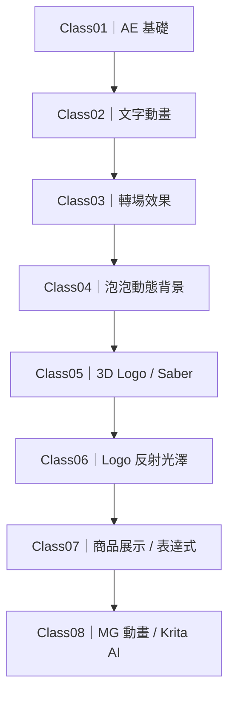
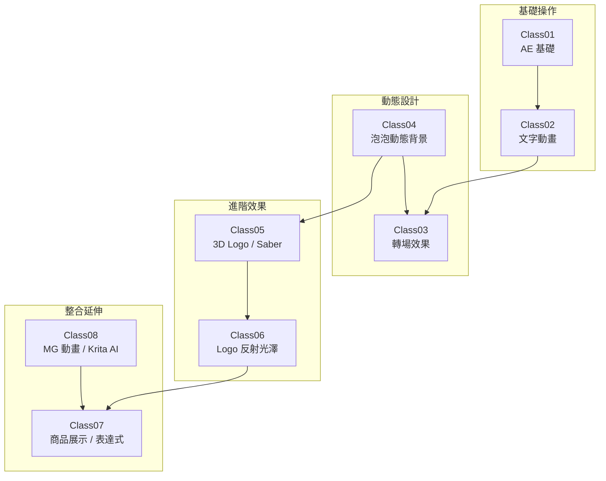
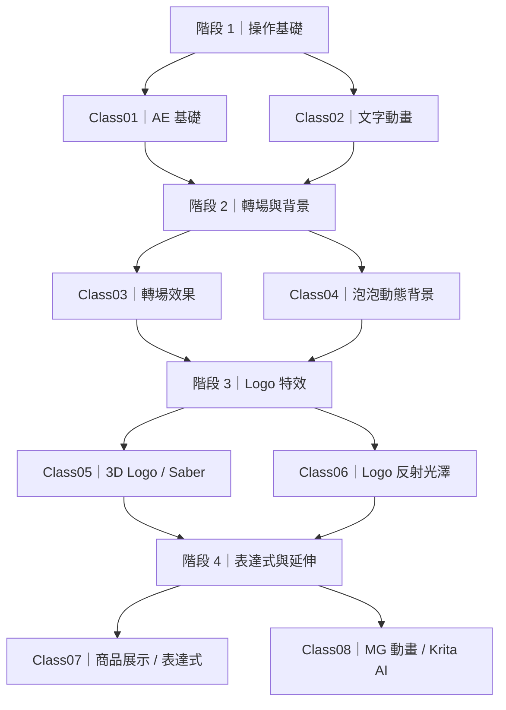
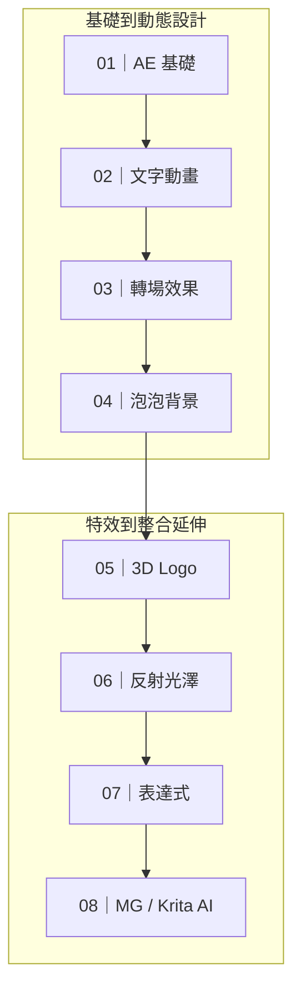
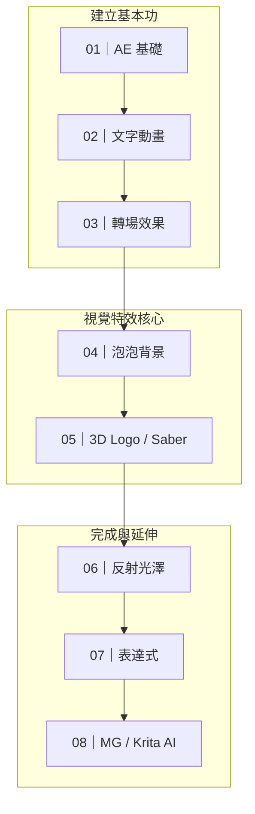
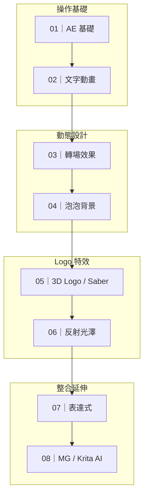

# 學習路線圖：六個候選版本

六版使用相同八堂課內容，只改變版面。A～C 是第一輪；D～F 是針對「不要太長或太寬、折線填滿單一畫面」新增的緊湊版本。

## 版本 A｜直式單一路線

優點：節點最大、手機閱讀清楚、先後順序最直觀。缺點：頁面較高。

## 版本 B｜雙欄蛇形

優點：比原圖高、又不會像直式版那麼長，桌面與手機較均衡。缺點：閱讀方向需要跟著箭頭轉彎。

## 版本 C｜四階段學習地圖

優點：課程概念分組最清楚，適合當課程導覽。缺點：不像 A 版那樣強調每一堂的線性順序。

## 建議

## 版本 D｜4 × 2 寬螢幕蛇形

四個節點一排、共兩排，適合桌面 README。順序沿第一排向右，再折到第二排向左；比例接近寬螢幕，但不會像原版八節點一字排開。

## 版本 E｜3–2–3 緊湊網格

上、下各三堂，中間兩堂作為銜接，長寬最接近一般內容區塊。折線只有兩次，仍可依箭頭讀出 Class01 → Class08。

## 版本 F｜2 × 4 配對階梯

每列兩堂、四列交錯折返，整體接近方形；每一列也剛好形成一個合理的學習配對。

## 選擇建議

- A：最大節點、純直式，但頁面最長。
- B：第一輪雙欄蛇形。
- C：強調四個能力階段，但連線較多。
- D：偏寬螢幕，適合桌面首頁。
- E：長寬最均衡，建議優先比較。
- F：接近方形，手機與桌面都容易閱讀。
