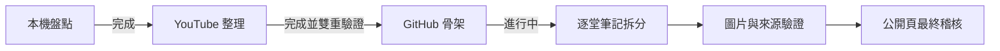

# 專案狀態

## 2026-11-12

- YouTube 播放清單已整理為 Class02～Class08；Class01 因當日未直播，沒有完整錄影。
- 2026-05-16 保留 Class04A／Class04B。
- Studio 與公開播放清單均驗證為 8 支，順序一致。
- 已建立本 Repo 與 MIT License。
- 下一階段：將累積式課堂筆記拆分成八堂獨立內容。

