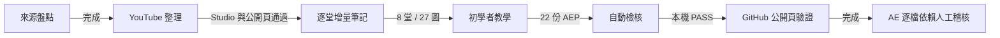

# 專案狀態

更新：2026-11-13

## 已驗證

- YouTube 播放清單為 Class02～Class08 共 8 支；Class01 未直播；Class04 分 A/B。
- 八份累積筆記已依日期／主題拆成八堂增量；27 張圖片均有來源行號、路徑、大小與 SHA-256。
- 教師身分已匿名化；不顯示單位；作者為 `4pins`。
- 22 份 AEP 共 9,256,090 bytes，保留練習過程，排除 Auto-Save、AME 暫存、影片與安裝程式。
- 本機驗證：23 份 Markdown、95 個檔案、27 個圖片引用、8 份來源 manifest，0 errors／0 warnings。
- `skills/ae-course-publisher` 已通過 `quick_validate.py`。

## 公開端驗證

- Repo 為 Public、Issues 為啟用、`main` 為預設分支。
- Browser Control 找到公開 README、Issues、11 張 Class01 渲染圖片、匿名教師文字與 Class08 AEP／manifest 連結。
- Raw 圖片與 AEP 分別回傳 HTTP 200，AEP 位元組與本機一致。
- 本機與 `origin/main` commit 已比對一致。
- GitHub 已建立 Mermaid render target；自動瀏覽器環境未取得最終 SVG，因此不把視覺渲染宣稱為完全驗證。

## 尚待

- 在一般互動式瀏覽器目視確認 Mermaid 最終 SVG（目前原始 Mermaid 語法與 GitHub render target 均存在）。
- 在 After Effects 逐份開啟 AEP，確認缺少的素材、字型與外掛；目前 manifest 標示為 `not_embedded-audit-required`。
